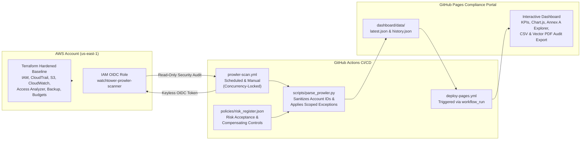

# Project Watchtower

[](https://michaelotega.github.io/project-watchtower/)
[-1d4ed8?style=flat-square)](https://michaelotega.github.io/project-watchtower/)
[](#repository-structure)
[](#security--grc-engineering-highlights)
[](#finops-guardrails)

**Live Compliance Dashboard:** [https://michaelotega.github.io/project-watchtower/](https://michaelotega.github.io/project-watchtower/)

Project Watchtower is an automated Cloud Security Posture Management (CSPM) and Governance, Risk, and Compliance (GRC) pipeline for AWS. It continuously audits infrastructure against **ISO/IEC 27001:2022**, enforces remediations as Terraform Infrastructure-as-Code, evaluates compensating controls through a version-controlled **Risk Register**, and publishes an interactive executive dashboard with one-click CSV and vector PDF audit exports -- all under a strict **$0.00/month** AWS spend guardrail.

---

## Architecture



---

## Measured Remediation Trajectory

Across iterative Terraform hardening passes and formal risk governance, automated compliance progressed from an unhardened baseline to zero open failures across **252 evaluated ISO/IEC 27001:2022 controls** (193 automated checks + 59 manual organizational/physical controls):

| Scan Milestone | Passed (Automated) | Raw Fails | Open Fails | Governed Exceptions | Raw Score | Governed Score |
| :--- | :---: | :---: | :---: | :---: | :---: | :---: |
| **Baseline Audit** | 83 | 81 | 44 | 37 | 50.6% | 73.2% |
| **Phase 3 Remediation (Pass 1)** | 141 | 51 | 12 | 39 | 73.4% | 93.8% |
| **Phase 3 Remediation (Pass 2)** | 148 | 45 | 1 | 44 | 76.7% | 99.5% |
| **Final Governed Posture** | **148** | **45** | **0** | **45** | **76.7%** | **100.0%** |

*Net improvement:* **+26.1%** strict raw automated pass rate, **+26.8%** governed compliance, and **-44** open failures eliminated without incurring paid AWS security tooling costs.

---

## Security & GRC Engineering Highlights

* **Keyless CI/CD Authentication (OIDC):** Eliminated long-lived AWS IAM access keys by federating GitHub Actions directly into a least-privilege read-only scanner role (`watchtower-prowler-scanner`) via OpenID Connect.
* **Terraform Hardened Baseline:** Codified an enterprise IAM Account Password Policy (14+ characters, rotation, 24-password reuse prevention), Account-Level S3 Block Public Access, TLS-enforced S3 audit/state buckets with lifecycle rules, dedicated S3 Server Access Logging, CloudTrail management event logging with 365-day CloudWatch log retention, 10 Always-Free CloudWatch metric filters and alarms, and a baseline AWS Backup vault/plan.
* **External Trust Governance (IAM Access Analyzer):** Enabled AWS IAM Access Analyzer and codified narrow Terraform archive rules for authorized external trusts -- including pinning the active Datadog monitoring integration (`DatadogIntegrationRole`) strictly to both the role ARN and Datadog's official AWS account (`464622532012`), ensuring unauthorized trust modifications still trigger active alerts.
* **Scoped Policy-as-Code Risk Register:** Rather than suppressing checks globally, `scripts/parse_prowler.py` evaluates `policies/risk_register.json` with optional `resource_contains` scoping. For example, `s3_bucket_server_access_logging_enabled` is marked `NOT_APPLICABLE` strictly on the dedicated `watchtower-access-logs` sink bucket (preventing an infinite recursive logging loop) while remaining strictly enforced on all other buckets.
* **Concurrency-Safe Telemetry Pipeline:** Added workflow-level concurrency locking (`group: watchtower-prowler-scan`) in `.github/workflows/prowler-scan.yml` to serialize overlapping scheduled and manual runs and prevent Git rebase conflicts on `dashboard/data/*.json`.
* **Sanitized Audit Evidence & Vector PDF Reporting:** Raw Prowler outputs stay out of version control (`.gitignore`), account IDs are masked prior to commit, and the static dashboard provides filterable Annex A control exploration, Risk Register cards, CSV export, and client-side vector PDF audit reports (`jsPDF` + `jspdf-autotable`) embedding live KPI cards, Chart.js canvases, color-coded findings tables, and a Risk Register appendix.

---

## FinOps Guardrails

Project Watchtower enforces an automated AWS Budgets guardrail (`$1.00/month` alert ceiling, `$0.00/month` target spend) by balancing security engineering with real-world cloud FinOps:

| Control Area | Paid Option Avoided | Zero-Cost Engineering / Compensating Control |
| :--- | :--- | :--- |
| **Log & Bucket Encryption** | AWS KMS Customer-Managed Keys ($1.00/key/mo + API fees) | Default AWS-managed AES-256 encryption + least-privilege IAM + documented Risk Acceptance |
| **Compliance Monitoring** | AWS Config / Security Hub / Backup Audit Manager | Open-source Prowler running on GitHub Actions free-tier runners + Terraform baseline |
| **Threat Detection & Alerting** | GuardDuty / Paid SIEM ingestion | CloudTrail management trail + 10 Always-Free CloudWatch metric alarms |
| **Dashboard Hosting** | EC2 / ECS / Amplify | Static GitHub Pages site auto-deployed via `workflow_run` |

---

## Repository Structure

```text
Project-WatchTower/
|-- .github/workflows/
|   |-- prowler-scan.yml          # OIDC AWS auth, Prowler ISO 27001 scan, parser, telemetry commit
|   \-- deploy-pages.yml          # Automated GitHub Pages deployment post-scan
|-- dashboard/
|   |-- index.html                # Executive GRC portal layout
|   |-- styles.css                # Print-safe blue-and-white audit UI
|   |-- app.js                    # Chart.js charts, filters, CSV & vector PDF generator
|   \-- data/
|       |-- latest.json           # Sanitized latest compliance snapshot
|       \-- history.json          # Time-series remediation trajectory
|-- infra/
|   |-- backend.tf                # Remote S3 state configuration
|   |-- providers.tf              # AWS provider & region setup
|   |-- budgets.tf                # FinOps budget alert guardrail
|   |-- cloudtrail.tf             # Management trail & S3 audit vault delivery
|   |-- s3_audit_vault.tf         # Hardened S3 buckets, logging sink, lifecycle policies
|   |-- remediation_core.tf       # IAM password policy, S3 PAB, Access Analyzer, Backup baseline
|   |-- remediation_monitoring.tf # CloudWatch Log Group (365d) & 10 Always-Free security alarms
|   \-- outputs.tf                # Key infrastructure outputs
|-- policies/
|   \-- risk_register.json        # Formal Risk Acceptance & N/A decisions with compensating controls
|-- scripts/
|   \-- parse_prowler.py          # Telemetry sanitizer, domain aggregator, scoped risk-register matcher
\-- README.md
```

---

## Local Dashboard Preview

Because the dashboard loads `dashboard/data/*.json` via `fetch()`, serve the `dashboard/` directory over local HTTP:

```powershell
python -m http.server 8000 --directory dashboard
```

Open `http://localhost:8000` in your browser to explore controls, filter by Annex A domain or governance status, and export CSV or PDF audit reports.

---

## Ownership & Governance

* **Author & Risk Owner:** Michael Loya (SecOps & GRC)
* **Compliance Standard:** ISO/IEC 27001:2022
* **Risk Register Review Cycle:** Quarterly